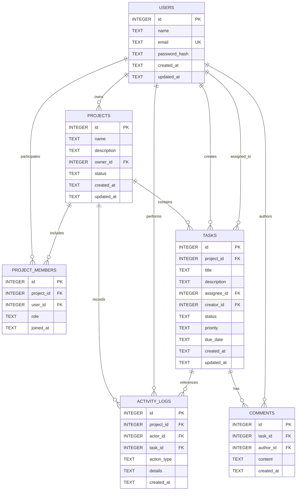

# Database Design & Schema Specification — TaskFlow

**Database Engine:** SQLite 3  
**Recommended Driver:** `better-sqlite3`  
**Storage Path:** `data/taskflow.db`  

---

## 1. Relational Entity Overview



---

## 2. Table Specifications

### 2.1. `users` Table
* **Purpose:** Stores authenticated user accounts.
* **Fields:**
  * `id`: `INTEGER PRIMARY KEY AUTOINCREMENT`
  * `name`: `TEXT NOT NULL` (Length: 2–100 chars)
  * `email`: `TEXT NOT NULL UNIQUE COLLATE NOCASE` (Normalized lowercase email)
  * `password_hash`: `TEXT NOT NULL` (bcrypt hash string)
  * `created_at`: `TEXT NOT NULL DEFAULT (datetime('now'))`
  * `updated_at`: `TEXT NOT NULL DEFAULT (datetime('now'))`
* **Indexes:**
  * `idx_users_email` ON `users(email)`
* **Deletion Policy:** Restrict or Soft-delete (User accounts should rarely be hard deleted if assigned to active tasks).

### 2.2. `projects` Table
* **Purpose:** Core container for collaborative work.
* **Fields:**
  * `id`: `INTEGER PRIMARY KEY AUTOINCREMENT`
  * `name`: `TEXT NOT NULL` (Length: 3–100 chars)
  * `description`: `TEXT` (Optional overview)
  * `owner_id`: `INTEGER NOT NULL`, `FOREIGN KEY (owner_id) REFERENCES users(id) ON DELETE RESTRICT`
  * `status`: `TEXT NOT NULL DEFAULT 'ACTIVE'` (`CHECK (status IN ('ACTIVE', 'COMPLETED', 'ARCHIVED'))`)
  * `created_at`: `TEXT NOT NULL DEFAULT (datetime('now'))`
  * `updated_at`: `TEXT NOT NULL DEFAULT (datetime('now'))`
* **Indexes:**
  * `idx_projects_owner` ON `projects(owner_id)`
  * `idx_projects_status` ON `projects(status)`
* **Deletion Policy:** `ON DELETE CASCADE` propagates to `tasks`, `project_members`, and `activity_logs`.

### 2.3. `project_members` Table
* **Purpose:** Junction table resolving the Many-to-Many relationship between `users` and `projects`.
* **Fields:**
  * `id`: `INTEGER PRIMARY KEY AUTOINCREMENT`
  * `project_id`: `INTEGER NOT NULL`, `FOREIGN KEY (project_id) REFERENCES projects(id) ON DELETE CASCADE`
  * `user_id`: `INTEGER NOT NULL`, `FOREIGN KEY (user_id) REFERENCES users(id) ON DELETE CASCADE`
  * `role`: `TEXT NOT NULL DEFAULT 'MEMBER'` (`CHECK (role IN ('OWNER', 'MEMBER'))`)
  * `joined_at`: `TEXT NOT NULL DEFAULT (datetime('now'))`
* **Constraints:**
  * `UNIQUE(project_id, user_id)` (A user can only belong to a project once)
* **Indexes:**
  * `idx_project_members_lookup` ON `project_members(project_id, user_id)`
  * `idx_project_members_user` ON `project_members(user_id)`

### 2.4. `tasks` Table
* **Purpose:** Individual work items associated with a project.
* **Fields:**
  * `id`: `INTEGER PRIMARY KEY AUTOINCREMENT`
  * `project_id`: `INTEGER NOT NULL`, `FOREIGN KEY (project_id) REFERENCES projects(id) ON DELETE CASCADE`
  * `title`: `TEXT NOT NULL` (Length: 1–150 chars)
  * `description`: `TEXT` (Markdown or plaintext content)
  * `assignee_id`: `INTEGER NULL`, `FOREIGN KEY (assignee_id) REFERENCES users(id) ON DELETE SET NULL`
  * `creator_id`: `INTEGER NOT NULL`, `FOREIGN KEY (creator_id) REFERENCES users(id) ON DELETE RESTRICT`
  * `status`: `TEXT NOT NULL DEFAULT 'TODO'` (`CHECK (status IN ('TODO', 'IN_PROGRESS', 'COMPLETED'))`)
  * `priority`: `TEXT NOT NULL DEFAULT 'MEDIUM'` (`CHECK (priority IN ('LOW', 'MEDIUM', 'HIGH', 'URGENT'))`)
  * `due_date`: `TEXT NULL` (ISO-8601 `YYYY-MM-DD` formatted date)
  * `created_at`: `TEXT NOT NULL DEFAULT (datetime('now'))`
  * `updated_at`: `TEXT NOT NULL DEFAULT (datetime('now'))`
* **Indexes:**
  * `idx_tasks_project_status` ON `tasks(project_id, status)`
  * `idx_tasks_assignee` ON `tasks(assignee_id)`
  * `idx_tasks_due_date` ON `tasks(due_date)`

### 2.5. `comments` Table
* **Purpose:** Discussion posts linked to individual tasks.
* **Fields:**
  * `id`: `INTEGER PRIMARY KEY AUTOINCREMENT`
  * `task_id`: `INTEGER NOT NULL`, `FOREIGN KEY (task_id) REFERENCES tasks(id) ON DELETE CASCADE`
  * `author_id`: `INTEGER NOT NULL`, `FOREIGN KEY (author_id) REFERENCES users(id) ON DELETE CASCADE`
  * `content`: `TEXT NOT NULL` (Trimmed, min length 1 char)
  * `created_at`: `TEXT NOT NULL DEFAULT (datetime('now'))`
* **Indexes:**
  * `idx_comments_task` ON `comments(task_id)`

### 2.6. `activity_logs` Table
* **Purpose:** Audit trail of critical project events.
* **Fields:**
  * `id`: `INTEGER PRIMARY KEY AUTOINCREMENT`
  * `project_id`: `INTEGER NOT NULL`, `FOREIGN KEY (project_id) REFERENCES projects(id) ON DELETE CASCADE`
  * `actor_id`: `INTEGER NOT NULL`, `FOREIGN KEY (actor_id) REFERENCES users(id) ON DELETE CASCADE`
  * `task_id`: `INTEGER NULL`, `FOREIGN KEY (task_id) REFERENCES tasks(id) ON DELETE SET NULL`
  * `action_type`: `TEXT NOT NULL` (e.g., `PROJECT_CREATED`, `TASK_CREATED`, `STATUS_CHANGED`, `MEMBER_ADDED`, `TASK_ASSIGNED`)
  * `details`: `TEXT` (Human-readable description or JSON metadata)
  * `created_at`: `TEXT NOT NULL DEFAULT (datetime('now'))`
* **Indexes:**
  * `idx_activity_project` ON `activity_logs(project_id, created_at DESC)`

---

## 3. SQLite DDL Reference Script (`src/models/schema.sql`)

When you create your migration file, it should declare:

```sql
PRAGMA foreign_keys = ON;

CREATE TABLE IF NOT EXISTS users (
    id INTEGER PRIMARY KEY AUTOINCREMENT,
    name TEXT NOT NULL,
    email TEXT NOT NULL UNIQUE COLLATE NOCASE,
    password_hash TEXT NOT NULL,
    created_at TEXT NOT NULL DEFAULT (datetime('now')),
    updated_at TEXT NOT NULL DEFAULT (datetime('now'))
);

CREATE TABLE IF NOT EXISTS projects (
    id INTEGER PRIMARY KEY AUTOINCREMENT,
    name TEXT NOT NULL,
    description TEXT,
    owner_id INTEGER NOT NULL,
    status TEXT NOT NULL DEFAULT 'ACTIVE' CHECK (status IN ('ACTIVE', 'COMPLETED', 'ARCHIVED')),
    created_at TEXT NOT NULL DEFAULT (datetime('now')),
    updated_at TEXT NOT NULL DEFAULT (datetime('now')),
    FOREIGN KEY (owner_id) REFERENCES users(id) ON DELETE RESTRICT
);

CREATE TABLE IF NOT EXISTS project_members (
    id INTEGER PRIMARY KEY AUTOINCREMENT,
    project_id INTEGER NOT NULL,
    user_id INTEGER NOT NULL,
    role TEXT NOT NULL DEFAULT 'MEMBER' CHECK (role IN ('OWNER', 'MEMBER')),
    joined_at TEXT NOT NULL DEFAULT (datetime('now')),
    UNIQUE(project_id, user_id),
    FOREIGN KEY (project_id) REFERENCES projects(id) ON DELETE CASCADE,
    FOREIGN KEY (user_id) REFERENCES users(id) ON DELETE CASCADE
);

CREATE TABLE IF NOT EXISTS tasks (
    id INTEGER PRIMARY KEY AUTOINCREMENT,
    project_id INTEGER NOT NULL,
    title TEXT NOT NULL,
    description TEXT,
    assignee_id INTEGER,
    creator_id INTEGER NOT NULL,
    status TEXT NOT NULL DEFAULT 'TODO' CHECK (status IN ('TODO', 'IN_PROGRESS', 'COMPLETED')),
    priority TEXT NOT NULL DEFAULT 'MEDIUM' CHECK (priority IN ('LOW', 'MEDIUM', 'HIGH', 'URGENT')),
    due_date TEXT,
    created_at TEXT NOT NULL DEFAULT (datetime('now')),
    updated_at TEXT NOT NULL DEFAULT (datetime('now')),
    FOREIGN KEY (project_id) REFERENCES projects(id) ON DELETE CASCADE,
    FOREIGN KEY (assignee_id) REFERENCES users(id) ON DELETE SET NULL,
    FOREIGN KEY (creator_id) REFERENCES users(id) ON DELETE RESTRICT
);

CREATE TABLE IF NOT EXISTS comments (
    id INTEGER PRIMARY KEY AUTOINCREMENT,
    task_id INTEGER NOT NULL,
    author_id INTEGER NOT NULL,
    content TEXT NOT NULL,
    created_at TEXT NOT NULL DEFAULT (datetime('now')),
    FOREIGN KEY (task_id) REFERENCES tasks(id) ON DELETE CASCADE,
    FOREIGN KEY (author_id) REFERENCES users(id) ON DELETE CASCADE
);

CREATE TABLE IF NOT EXISTS activity_logs (
    id INTEGER PRIMARY KEY AUTOINCREMENT,
    project_id INTEGER NOT NULL,
    actor_id INTEGER NOT NULL,
    task_id INTEGER,
    action_type TEXT NOT NULL,
    details TEXT,
    created_at TEXT NOT NULL DEFAULT (datetime('now')),
    FOREIGN KEY (project_id) REFERENCES projects(id) ON DELETE CASCADE,
    FOREIGN KEY (actor_id) REFERENCES users(id) ON DELETE CASCADE,
    FOREIGN KEY (task_id) REFERENCES tasks(id) ON DELETE SET NULL
);

-- Optimization Indexes
CREATE INDEX IF NOT EXISTS idx_users_email ON users(email);
CREATE INDEX IF NOT EXISTS idx_projects_owner ON projects(owner_id);
CREATE INDEX IF NOT EXISTS idx_project_members_lookup ON project_members(project_id, user_id);
CREATE INDEX IF NOT EXISTS idx_tasks_project_status ON tasks(project_id, status);
CREATE INDEX IF NOT EXISTS idx_tasks_assignee ON tasks(assignee_id);
CREATE INDEX IF NOT EXISTS idx_comments_task ON comments(task_id);
CREATE INDEX IF NOT EXISTS idx_activity_project ON activity_logs(project_id, created_at DESC);
```

---

## 4. Concurrency & Transaction Rules

1. **Foreign Key Enforcement:**  
   Always execute `PRAGMA foreign_keys = ON;` whenever establishing a connection in SQLite. By default, SQLite disables foreign keys.
2. **Atomic Project Creation:**  
   When a user creates a project, inserting the project record AND inserting the owner into `project_members` MUST happen inside a single transaction (`BEGIN TRANSACTION ... COMMIT;`). If the member insertion fails, rollback the project creation.
