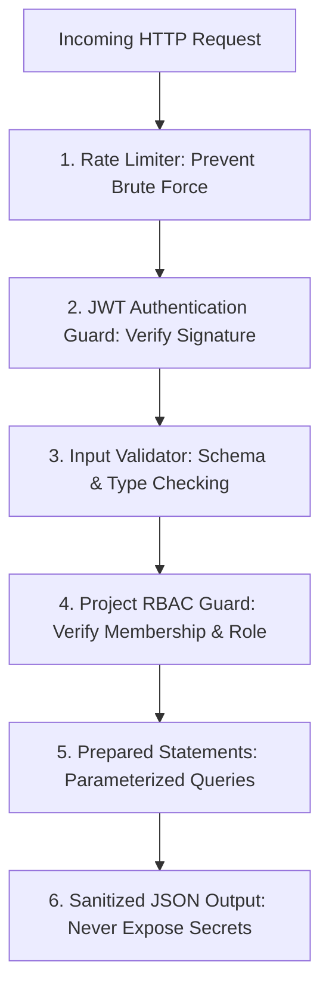

# Security Architecture & Threat Model — TaskFlow

**Security Standard:** OWASP Top 10 Compliance for Web Applications  
**Scope:** `CodeAlpha_ProjectManagementTool`  

---

## 1. Threat Modeling & Core Defense Mechanisms



---

## 2. Authentication & Credential Security

### 2.1. Password Hashing
* **Standard:** `bcryptjs` with salt round cost factor $\ge 10$.
* **Rules:**
  * Plaintext passwords must never be logged, cached, or persisted.
  * Passwords must enforce a minimum length of 8 characters.
  * Salting is performed automatically per-user by bcrypt to defeat rainbow table attacks.

### 2.2. Secret Key Management
* `JWT_SECRET` must be set via the `.env` environment file.
* A strong, high-entropy secret (at least 256 bits / 32 characters) must be used.
* The `.env` file is explicitly ignored in `.gitignore` and must never be committed to Git.

### 2.3. Token Handling
* Claims stored in JWT: Only `id` and `email`.
* **Prohibited Claims:** Never store password hashes, administrative overrides, or sensitive profile secrets in tokens.
* Tokens are issued with a reasonable time-to-live (`expiresIn: '24h'`).

---

## 3. Authorization & Broken Object-Level Authorization (BOLA/IDOR) Defense

**The #1 Risk in Project Management Tools:** A user logged in as User A manipulates the URL (e.g., `PATCH /api/projects/999/tasks/42`) to view or edit tasks in Project 999 belonging to another organization.

### Strict Server-Side RBAC Enforcement:
1. **Never trust client-supplied project IDs blindly.**
2. Before any task, member, or project mutation or retrieval:
   ```sql
   -- The query must verify user membership:
   SELECT role FROM project_members 
   WHERE project_id = ? AND user_id = ?;
   ```
3. If no row is returned, the server must immediately return `403 Forbidden` (or `404 Not Found` if information hiding is desired).
4. For administrative operations (e.g., changing project name, deleting project, adding/removing members), verify `role === 'OWNER'`.

---

## 4. SQL Injection Prevention

* **Strict Rule:** **ZERO dynamic string concatenation or template literals in SQL queries.**
* **Bad Practice (Vulnerable):**
  ```javascript
  // NEVER DO THIS:
  db.prepare(`SELECT * FROM users WHERE email = '${email}'`);
  ```
* **Enforced Practice (Secure):**
  ```javascript
  // ALWAYS USE PARAMETERS:
  db.prepare('SELECT * FROM users WHERE email = ?').get(email);
  ```

---

## 5. Cross-Site Scripting (XSS) Prevention

* Task titles, descriptions, and user comments are user-generated content.
* **Frontend Rule:** Use `element.textContent = userString;` instead of `element.innerHTML = userString;`.
* When rendering markdown or rich text, sanitize using DOMPurify or strip raw HTML tags.

---

## 6. Output Sanitization & Error Handling

* **Password Hash Stripping:** User queries returning profile data must explicitly exclude the `password_hash` column:
  ```sql
  SELECT id, name, email, created_at FROM users WHERE id = ?;
  ```
* **Internal Server Errors:** In production (`NODE_ENV === 'production'`), error responses must return generic messages (`"Internal Server Error"`) rather than raw database error objects or stack traces.

---

## 7. Audit Logging

* Key security events (failed logins, project deletions, role elevations, member evictions) must be logged with timestamp and actor IP/ID.
