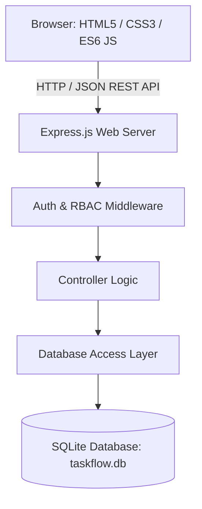

# Technical Requirements Document (TRD) — TaskFlow

**Document Version:** 1.0.0  
**Stack:** Node.js, Express.js, SQLite, Vanilla HTML/CSS/JavaScript  

---

## 1. Architectural Overview

TaskFlow utilizes a clean, decoupled client-server architecture:
* **Presentation Tier (Frontend):** Modern Vanilla HTML5, CSS3, and ES6+ JavaScript. Operates as a responsive Single/Multi-Page Application hybrid, interacting with the backend purely through a RESTful JSON API using standard `fetch()`.
* **Application Tier (Backend):** Node.js and Express.js REST API with layered separation of concerns:
  * Routing Layer (`routes/`)
  * Middleware Layer (`middleware/`)
  * Controller / Business Logic Layer (`controllers/`)
  * Data Access / Query Layer (`models/` or `services/`)
* **Persistence Tier (Database):** SQLite3 managed file database with enforced relational integrity via foreign keys.



---

## 2. Tier Responsibilities & Boundaries

### 2.1. Frontend Responsibilities
* Render responsive UI components (navigation, modals, task boards, metric cards).
* Manage local client state (active project ID, user session token/cookie, active filters).
* Perform client-side pre-validation (non-empty fields, email format, matching password confirmation).
* Execute asynchronous API requests and handle loading spinners, error banners, and empty states.
* Prevent XSS by strictly utilizing safe DOM insertion methods (`textContent`, DOM element creation).

### 2.2. Backend Responsibilities
* Enforce security: request validation, authentication token verification, and role-based authorization.
* Execute parameterized SQL queries with atomic transaction blocks for multi-record operations.
* Hash and verify credentials with `bcryptjs`.
* Formulate consistent JSON envelopes and appropriate HTTP status codes.
* Provide static asset serving for frontend files (`public/`).

---

## 3. Module Boundaries & Directory Layout

```
CodeAlpha_ProjectManagementTool/
├── docs/                      # Architectural & design specifications
├── public/                    # Static frontend client files
│   ├── css/
│   │   ├── main.css           # Global design tokens, typography, layout
│   │   ├── auth.css           # Authentication screens
│   │   ├── dashboard.css      # Analytics & dashboard styling
│   │   └── project.css        # Kanban board & task cards
│   ├── js/
│   │   ├── api.js             # Reusable Fetch API wrapper
│   │   ├── auth.js            # Auth state & token handling
│   │   ├── dashboard.js       # Dashboard metric rendering
│   │   ├── projects.js        # Project CRUD & task management
│   │   └── ui.js              # Modals, toasts, UI helpers
│   ├── index.html             # Main dashboard & application shell
│   ├── login.html             # Login view
│   └── register.html          # Registration view
├── src/                       # Backend Express application source
│   ├── config/
│   │   └── db.js              # SQLite connection & PRAGMA configuration
│   ├── controllers/           # HTTP request handlers
│   │   ├── authController.js
│   │   ├── projectController.js
│   │   ├── taskController.js
│   │   ├── commentController.js
│   │   └── dashboardController.js
│   ├── middleware/            # Security & routing guards
│   │   ├── authMiddleware.js  # Token/session verification
│   │   ├── rbacMiddleware.js  # Project membership & ownership verification
│   │   └── errorHandler.js    # Centralized error formatting
│   ├── models/                # Schema definitions & database query logic
│   │   ├── schema.sql         # DDL script for database initialization
│   │   ├── userModel.js
│   │   ├── projectModel.js
│   │   ├── taskModel.js
│   │   └── activityModel.js
│   └── utils/
│       ├── logger.js          # Structured console logger
│       └── validator.js       # Validation helper functions
├── .env.example               # Template environment configuration
├── .gitignore                 # Version control exclusions
├── package.json               # Dependencies & npm scripts
└── server.js                  # Application entry point
```

---

## 4. Request & Response Lifecycle

1. **Incoming Request:** Client sends an HTTP request (`GET`, `POST`, `PATCH`, `DELETE`).
2. **Body Parsing & CORS:** `express.json()` and `cors()` process headers and payload.
3. **Authentication Check:** `authMiddleware.js` extracts the bearer token from the `Authorization` header or HTTP-only cookie. Verifies signature via `jsonwebtoken`. Attaches decoded payload `req.user = { id, email, name }`.
4. **Authorization Check (RBAC):** For scoped routes (e.g., `/api/projects/:projectId/...`), `rbacMiddleware.js` inspects `req.params.projectId` against the database to confirm `req.user.id` is a member or owner. If not authorized, halts immediately with `403 Forbidden`.
5. **Controller & Business Logic:** Validates request parameters and coordinates data operations.
6. **Data Access:** Executes parameterized SQL via SQLite prepared statements.
7. **Response Serialization:** Emits structured JSON:
   * **Success:** `HTTP 200/201` -> `{ "success": true, "data": { ... } }`
   * **Client Error:** `HTTP 400/401/403/404` -> `{ "success": false, "error": "Message" }`
   * **Server Error:** `HTTP 500` -> `{ "success": false, "error": "Internal Server Error" }` (safe message, no exposed stack traces).

---

## 5. Authentication & State Strategy

* **Mechanism:** JSON Web Tokens (JWT) or Session Cookies.
* **Algorithm:** `HS256` signed with a server-side secret (`JWT_SECRET`).
* **Expiration:** Recommended 24 hours (`24h`) for desktop sessions.
* **Password Hashing:** `bcryptjs` with salt round factor of 10.
* **Payload Contents:** `{ id: user.id, email: user.email }` (No sensitive credentials, passwords, or hashes).

---

## 6. Database Strategy

* **Engine:** SQLite 3 (stored as `data/taskflow.db`).
* **Driver:** `better-sqlite3` (synchronous execution, optimal for SQLite's local file architecture, avoids callback complexity) or `sqlite3`.
* **Pragmas:**
  * `PRAGMA foreign_keys = ON;` (Mandatory: enforces FK constraints).
  * `PRAGMA journal_mode = WAL;` (Write-Ahead Logging for high concurrency and resilience).

---

## 7. Environment Configuration

All environment-specific variables are managed via `.env` and loaded using `dotenv`:

| Variable | Default Value | Description |
| :--- | :--- | :--- |
| `PORT` | `3000` | Port for the Express HTTP server |
| `NODE_ENV` | `development` | Runtime environment (`development` / `production`) |
| `JWT_SECRET` | *(Random 32+ char secret)* | Secret key for signing and verifying tokens |
| `DB_PATH` | `./data/taskflow.db` | Relative or absolute path to SQLite file |

---

## 8. Deployment & Operational Considerations

* **Data Persistence:** Because SQLite is a file-based database, ensure the directory containing `taskflow.db` has write permissions and is included in backup routines.
* **Port Binding:** Defaults to `process.env.PORT || 3000` to support containerized or platform deployments (e.g., Render, Railway, VPS).
